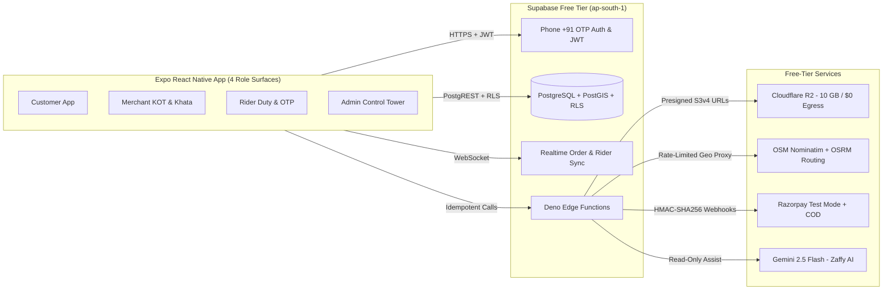
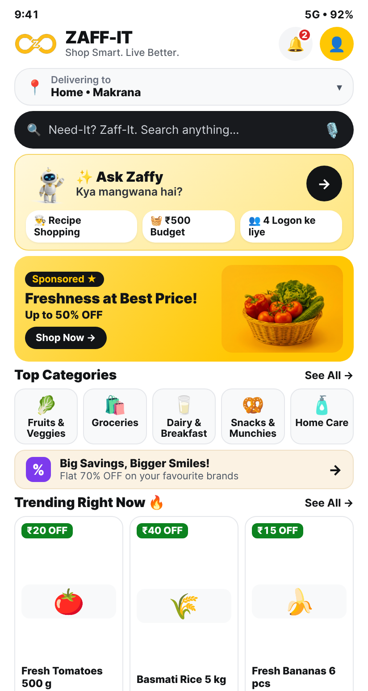
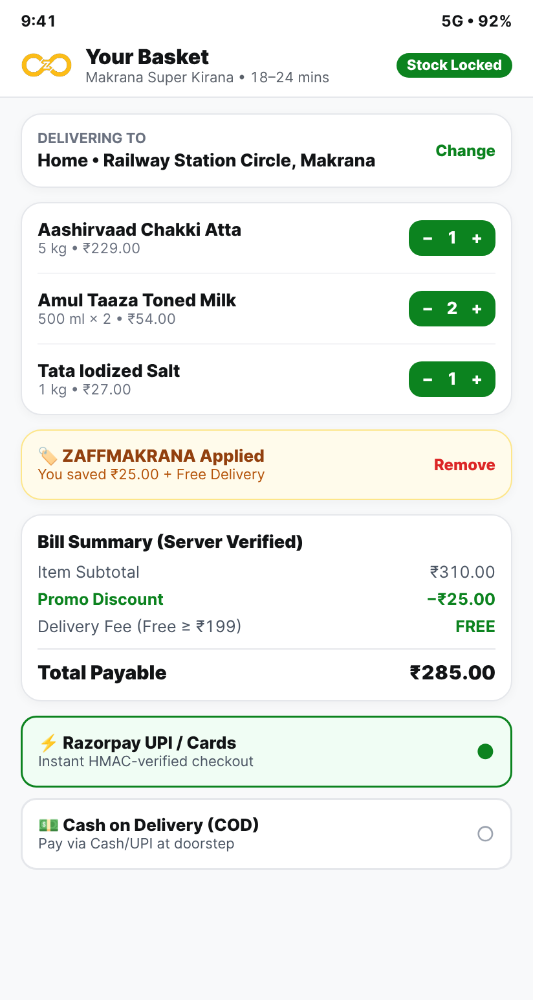
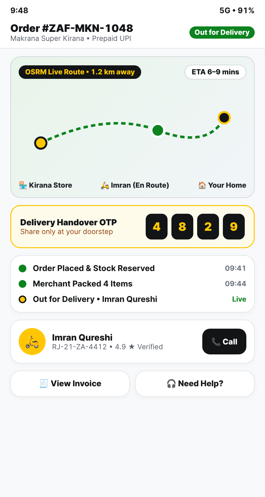
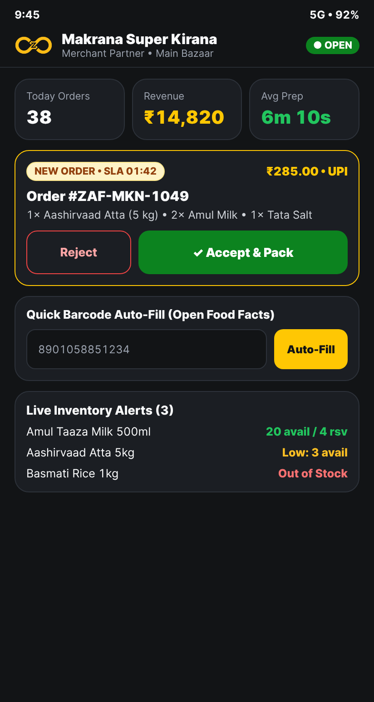
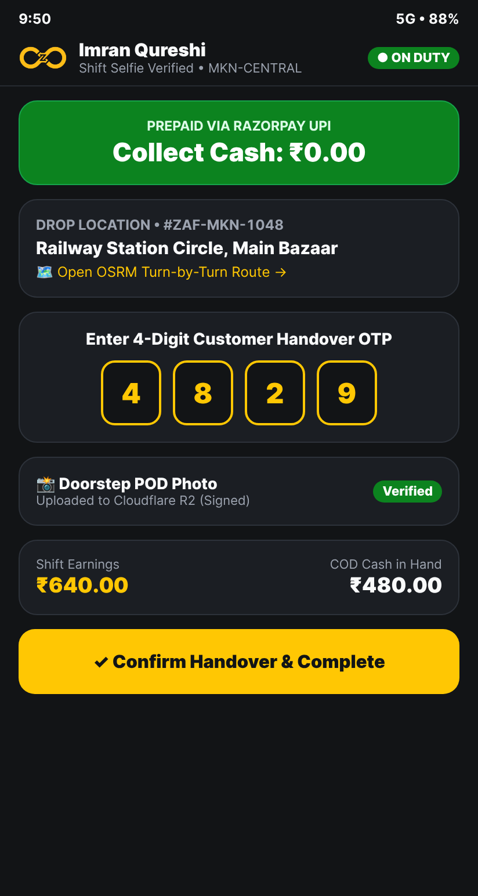
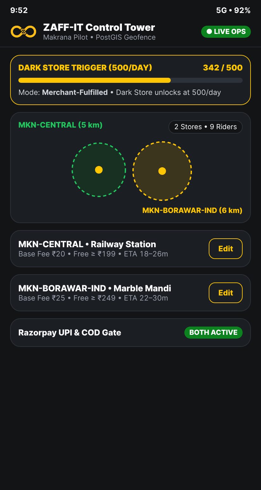

# ZAFF-IT — Hyperlocal Quick-Commerce Ecosystem

> **"Need It? Zaff-It!"**  
> **Company:** ZaffmIND Technology / ZAFF Group  
> **Pilot Region:** Makrana, Rajasthan (`MKN-CENTRAL` & `MKN-BORAWAR-IND`)  
> **Operating Model:** Merchant-Fulfilled Pilot → Feature-Flagged Dark Store Rollout at **500 orders/day**

ZAFF-IT is a unified, multi-surface hyperlocal quick-commerce platform built on a **₹0/month 100% Free-Tier & Open-Source MVP stack**, serving **Customer**, **Merchant**, **Rider**, and **Admin Control Tower** workflows from a single canonical PostgreSQL schema.

---

## ✨ Premium UI v2 (November 2026 Refresh)

The full surface set has been upgraded to a **premium, smooth, professional** visual language built directly from the founder's reference designs:

- **Cinematic dark splash** — golden infinity wordmark, Makrana rider mascot hero art, animated fade-in, language picker & trust pills
- **Golden signature tab bar** — active-route gold underline indicator, black infinity-logo ZAFF pill, green basket badge, dark variant for Merchant/Rider/Admin consoles
- **Ask Zaffy card** — 3D black-gold Zaffy mascot (custom brand render), warm golden gradient surface with glow
- **Promo carousel banner** — real brand banner art, Sponsored pill, Shop Now CTA
- **Emoji product art tiles** — lightweight premium product visuals with ETA chips and green discount badges
- **Merchant Partner console** — black KPI stats bar, LIVE badge + logo tile header, golden glow CTAs
- Design tokens extended: `BRAND_GRADIENTS`, `GLOW`, `MOTION`, `PRODUCT_ART` (`packages/shared/src/tokens.ts`)
- **`BACKEND_CONNECT.md`** — step-by-step Hindi+English backend setup guide (Supabase → OTP auth → SQL → Edge Functions → Razorpay → R2 → Gemini → EAS)

---

## Architecture Overview



---

## 100% Free-Tier MVP Stack

| Layer | Provider / Tool | Free-Tier Limits & Constraints | Revenue Upgrade Trigger |
| :--- | :--- | :--- | :--- |
| **Database, Auth, Realtime & Edge** | [Supabase Free Tier](https://supabase.com/pricing) | 500 MB Postgres, 50,000 MAUs, 5 GB egress, 500K [Edge Function calls/mo](https://supabase.com/docs/guides/functions/pricing) (pauses after 7 days idle) | DB > 400 MB, MAUs > 40K, or live pilot requires zero auto-pause |
| **Media & KYC Storage** | [Cloudflare R2 Free Tier](https://developers.cloudflare.com/r2/pricing/) | 10 GB-mo storage, 1M Class A ops, 10M Class B ops, **$0 egress** | Catalogue + KYC selfies > 10 GB |
| **Maps, Geocoding & Routing** | [OSM Nominatim](https://operations.osmfoundation.org/policies/nominatim/) + [OSRM](https://github.com/project-osrm/osrm-backend) | Nominatim max 1 req/sec (proxied & cached in Postgres); OSRM demo router | > 50–100 concurrent active orders |
| **Payments** | [Razorpay Test Mode](https://razorpay.com/docs/webhooks/validate-test) + COD | ₹0/mo in Test Mode (`rzp_test_*`), HMAC-SHA256 webhooks + COD | Live real-money Makrana launch post-KYC |
| **Zaffy AI Assistant** | [Gemini API Free Tier](https://aistudio.google.com/docs/rate-limits) | ₹0/mo via Google AI Studio (`gemini-2.5-flash`, strictly read-only) | Daily queries approach Free Tier RPD/RPM |
| **Mobile Builds & OTA** | [Expo / EAS Free Tier](https://expo.dev/pricing) | 15 Android + 15 iOS builds/mo, 1,000 MAUs on Expo Update | > 1,000 MAUs or > 15 builds/mo |
| **Fulfilment Model** | Merchant-Fulfilled Pilot | Uses existing Makrana partner kirana/mart inventory | **500 orders/day in Makrana** (`dark_store_enabled` flag) |

---

## Visual UI Previews (Design System v1.0)

All screens enforce **ZAFF-IT Design System v1.0** (`packages/shared/src/tokens.ts`): Charcoal Black (`#121416`), Golden Yellow (`#FFC703`), Electric Green (`#0C831F`), strict `>= 11px` typography floor, and `>= 44dp` touch targets.

| Customer Home Hub | Cart & Checkout | Live Order Tracking |
| :---: | :---: | :---: |
|  |  |  |

| Merchant KOT Dashboard | Rider Delivery OTP | Admin Ops & Geofence |
| :---: | :---: | :---: |
|  |  |  |

---

## Repository Structure

```text
ZAFF-IT/
├── .env.example                                  # Public Expo & server-only secret template
├── .gitignore                                    # Node, Expo, .env, native builds, Supabase temp
├── package.json                                  # Root monorepo workspace scripts
├── README.md
├── docs/
│   ├── API_CONTRACTS.md                          # REST, RPC & Edge Function payload contracts
│   ├── BACKEND_AND_API_CONNECTION_GUIDE.md       # Step-by-step Free-Tier infra setup
│   ├── ui-ux-audit-and-design-system.md          # 190-screen Stitch audit & Design System v1.0
│   └── screenshots/                              # 6 rendered mobile UI previews (412x915 @2x)
├── infrastructure/
│   └── database/
│       ├── 001_initial_schema.sql                # Core enums, PostGIS zones, stores, profiles
│       ├── 002_rls_policies.sql                  # Role-scoped Row-Level Security policies
│       ├── 003_atomic_rpcs.sql                   # Atomic inventory reservation & order RPCs
│       └── 004_seed_makrana.sql                  # Makrana zones, stores, SKUs & ZAFFMAKRANA promo
└── packages/
    └── shared/
        └── src/
            └── tokens.ts                         # Unified color, typography, spacing & touch tokens
```

---

## Quickstart

### 1. Environment Setup
```bash
cp .env.example .env
```
Populate only `EXPO_PUBLIC_*` variables in `.env`. Never place `SUPABASE_SERVICE_ROLE_KEY`, `R2_SECRET_ACCESS_KEY`, `RAZORPAY_KEY_SECRET`, or `GEMINI_API_KEY` in `.env`.

### 2. Database & Seed Setup (Supabase Mumbai `ap-south-1`)
```bash
npx supabase login
npx supabase link --project-ref <your-project-ref>
npm run db:push
```
Run `infrastructure/database/001_initial_schema.sql` through `004_seed_makrana.sql` sequentially to provision Makrana service zones (`MKN-CENTRAL`, `MKN-BORAWAR-IND`), sample stores (*Makrana Super Kirana*, *Marwar Fresh Mart*), and the `ZAFFMAKRANA` launch promo.

### 3. Deploy Edge Functions & Secrets
```bash
npx supabase secrets set \
  R2_ACCOUNT_ID="<id>" R2_ACCESS_KEY_ID="<key>" R2_SECRET_ACCESS_KEY="<secret>" \
  RAZORPAY_KEY_ID="rzp_test_xxx" RAZORPAY_KEY_SECRET="<secret>" RAZORPAY_WEBHOOK_SECRET="<secret>" \
  GEMINI_API_KEY="<key>" NOMINATIM_USER_AGENT="ZAFF-IT-Makrana/1.0 (ops@zaffmind.in)"

npm run functions:deploy
```

### 4. Run Mobile App
```bash
npm install
npm run dev
```

---

## Documentation

- [Backend & API Connection Guide](docs/BACKEND_AND_API_CONNECTION_GUIDE.md) — Free-Tier Supabase, Cloudflare R2, Razorpay Test Mode, Nominatim/OSRM, and EAS Build setup.
- [API Contracts Reference (v1.0)](docs/API_CONTRACTS.md) — Global headers, idempotency keys, error envelopes, and endpoint schemas.
- [UI/UX Audit & Unified Design System (v1.0)](docs/ui-ux-audit-and-design-system.md) — 190-screen audit, consolidated navigation map, and accessibility rules.

---

## Core Architectural Guardrails

1. **Integer Paise Only:** All monetary values (`*_paise`) are stored and transmitted as integers (e.g., `₹199.00` = `19900`).
2. **UTC Timestamps:** Stored in `TIMESTAMPTZ` UTC ISO-8601; formatted to `Asia/Kolkata` (`IST`, `+05:30`) in the UI.
3. **Atomic Inventory Reservation:** Checkout reserves `available_to_sell = on_hand_qty - reserved_qty >= requested_qty` inside a single PostgreSQL transaction.
4. **Idempotency Everywhere:** Checkout, payment initiation, and Razorpay HMAC-SHA256 webhooks enforce `Idempotency-Key` deduplication.
5. **Read-Only Zaffy AI:** Zaffy AI (`gemini-2.5-flash`) assists with search and cart guidance only and never mutates prices, stock, refunds, or dispatch.
